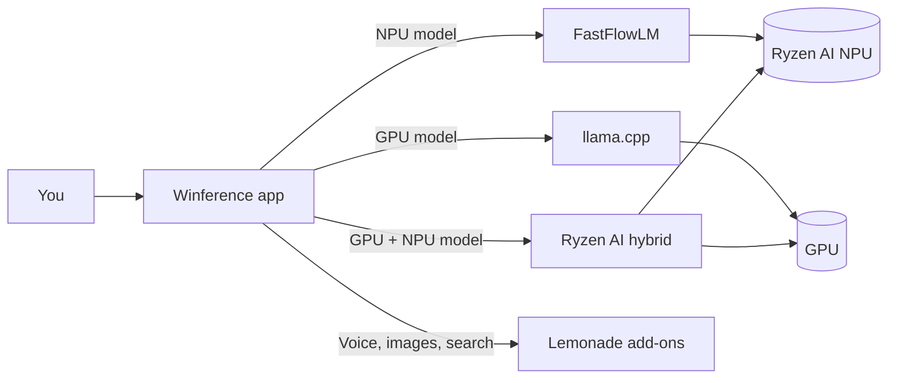

<div align="center">


# Winference

**Private AI chat that runs on your PC's NPU and GPU. No cloud. No account.**

[](https://github.com/pradhankukiran/winference/actions/workflows/release.yml)
[](https://github.com/pradhankukiran/winference/releases/tag/latest-build)
[](LICENSE)

[](#requirements)
[](#build-from-source)
[](#build-from-source)
[](#build-from-source)
[](#supported-hardware)
[](#how-it-works)

<br>

<a href="https://github.com/pradhankukiran/winference/releases/tag/latest-build">
  
</a>

</div>

---

## Why Winference

- **Private by design.** Your chats, documents and pictures never leave your PC.
- **Uses the AI chip you paid for.** Runs models on the AMD Ryzen AI NPU, the GPU, or both together.
- **No setup.** Pick a model and start chatting. Winference chooses the right engine for it.
- **Works offline.** After a model is downloaded, no internet is needed.

## Features

| Chat | Models | Attachments | Voice and images |
|---|---|---|---|
| Custom instructions | One-click download, use and remove | Documents and PDFs | Read replies aloud |
| Precise, Balanced or Creative replies | NPU, GPU and GPU + NPU filters | Pictures, with vision models on the NPU | Speech input |
| Edit and resend; regenerate | Engine picked from the model | Search by meaning across your files | Image generation |
| Export a chat to Markdown | Load on typing, unload when idle | Optional tools that ask before touching files | |
| Reply speed under every answer | | | |

## How it works



Each model is built for one engine, so Winference reads the model and starts the matching engine.
NPU, GPU and GPU + NPU are filters on the model list, not modes you have to manage.

## Supported hardware

| Mode | Engine | Hardware |
|---|---|---|
| NPU | FastFlowLM | AMD Ryzen AI 300 series and newer (XDNA 2 NPU) |
| GPU | llama.cpp (Vulkan) | GPUs with Vulkan support |
| GPU + NPU | Ryzen AI hybrid | AMD Ryzen AI 300 series and newer |

Tested on an AMD Ryzen AI 7 350 with Radeon 860M graphics.

## Quick start

1. **Install.** Download the installer from [Releases](https://github.com/pradhankukiran/winference/releases/tag/latest-build) and run it.
   It installs for your account only, with no admin rights.
2. **Get a model.** Open **Models**, pick one and choose **Get**.
3. **Chat.** Choose **Use it now** and start typing.

> [!NOTE]
> The installer is not code-signed yet. If Windows SmartScreen warns you, choose **More info**, then **Run anyway**.

## Privacy

- Chats, settings and models are stored in `%LOCALAPPDATA%\Winference` on your PC.
- Winference downloads only what you ask for: models, engines and add-ons.
- There is no telemetry and no account.
- Uninstalling asks whether to delete your chats and models too.

## Requirements

- Windows 11 22H2 or later, x64
- AMD Ryzen AI processor for NPU and GPU + NPU models
- A Vulkan-capable GPU for GPU models

## Build from source

Requires the .NET SDK 10.0.402 (pinned in `global.json`) on Windows.

```powershell
# Build
scripts\Build-Windows.ps1

# Run unit tests
scripts\Test-Windows.ps1

# Build the app folder and the installer (needs Inno Setup 6)
scripts\Build-Windows.ps1 -Installer
```

The installer is written to `artifacts\installer\Winference-Setup-<version>.exe`.

### Releases

- Every push to `main` that changes the app rebuilds the installer and updates **Latest build**.
- Pushing a tag such as `v1.0.1` also creates a permanent release.

### Project layout

| Folder | Contents |
|---|---|
| `src/Winference.Core` | Models, runtime contracts, chat and tool logic |
| `src/Winference.Infrastructure` | Engines, downloads and storage |
| `src/Winference.App` | WinUI 3 desktop app |
| `tests/Winference.Tests` | Unit tests |
| `config` | Model catalogs and model profiles |
| `external` | Bundled Lemonade server and third-party notices |
| `installer` | Inno Setup script |

## Roadmap

- [ ] Vision models on the GPU
- [ ] Search by meaning on the NPU
- [ ] Reranker for sharper document answers
- [ ] Quick-ask hotkey from anywhere in Windows
- [ ] Local API for tools such as Open WebUI
- [ ] Code-signed installer

## Credits

Winference builds on these projects:

- [FastFlowLM](https://github.com/FastFlowLM/FastFlowLM) for NPU inference
- [Lemonade](https://github.com/lemonade-sdk/lemonade) for the local model server and add-ons
- [llama.cpp](https://github.com/ggml-org/llama.cpp) for GPU inference
- [AMD Ryzen AI](https://www.amd.com/en/developer/resources/ryzen-ai-software.html) and [ONNX Runtime GenAI](https://github.com/microsoft/onnxruntime-genai) for GPU + NPU inference

Their licenses are in `external/notices` and `external/*/LICENSE`.

## License

Winference is released under the [MIT License](LICENSE).
